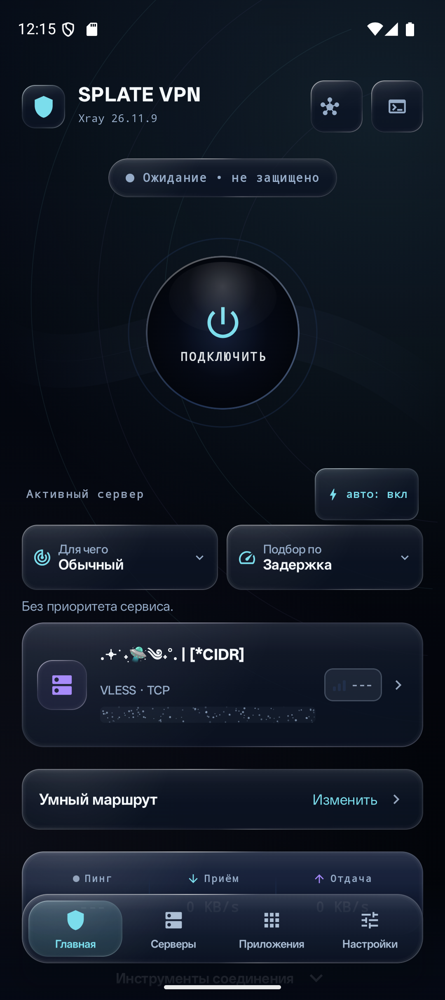
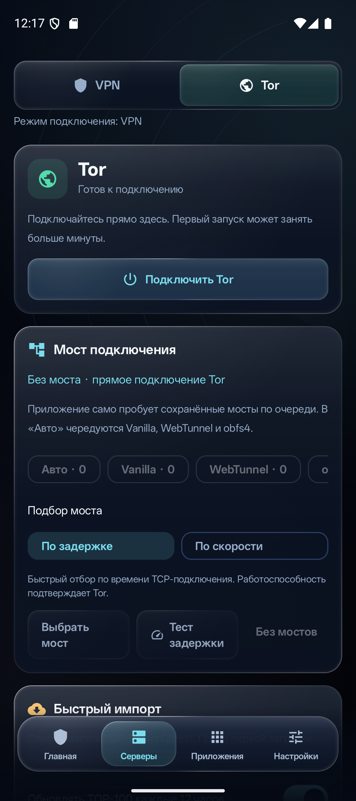
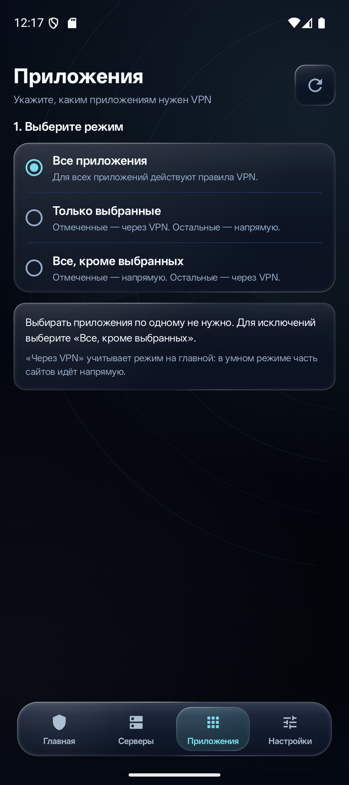
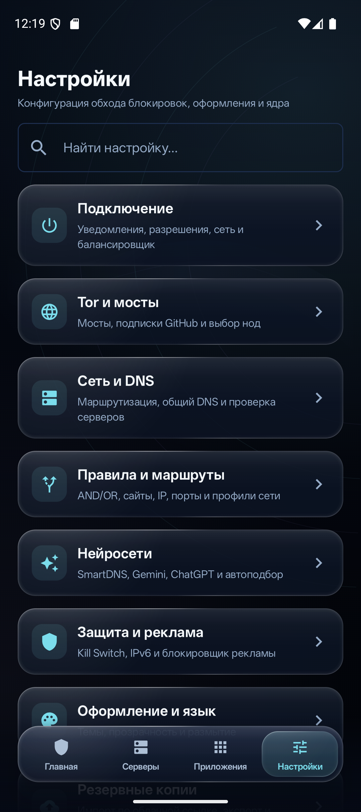
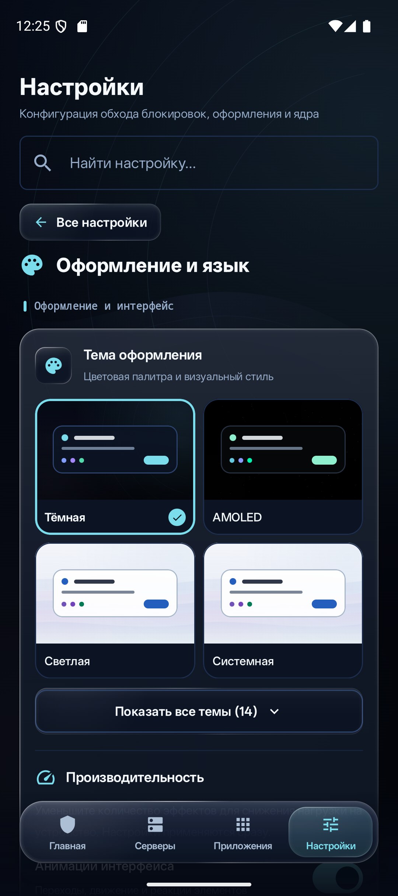
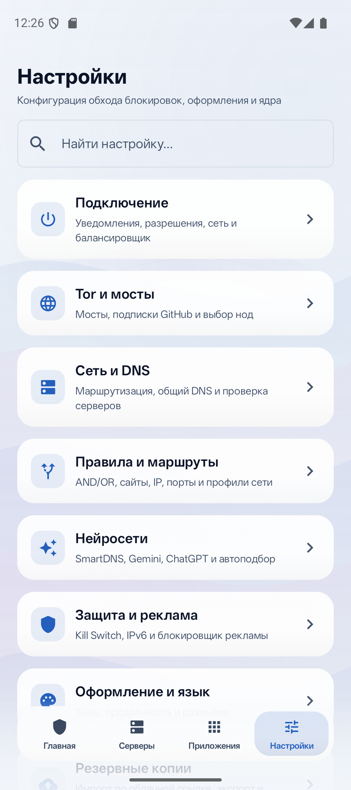

# SplateVPN for Android

[Русский](README.md) · **English**

A VPN client with Xray, AmneziaWG, and Tor for Android 8.0 and later, including Android TV.

[](https://github.com/splatedk-web/splatevpn-xray-client/stargazers)


[Download APK](https://github.com/splatedk-web/splatevpn-xray-client/releases) · [Windows](https://github.com/splatedk-web/splatevpn-xray-client-windows) · [Linux](https://github.com/splatedk-web/splatevpn-xray-client-linux) · [Changelog](CHANGELOG.md)

## Features

- VLESS, VMess, Trojan, Shadowsocks, Hysteria2, AmneziaWG, WireGuard, and SOCKS5. Import links, QR codes, subscriptions, AWG files, and Xray JSON profiles.
- Automatic selection by latency or speed, with failover to a backup server.
- Per-app and domain routing, Smart DNS, DoH, and DNS-based ad filtering.
- Tor with direct connections or obfs4, WebTunnel, and Snowflake bridges. Tor mode carries TCP and DNS.
- Widgets, a Quick Settings tile, traffic statistics, backups, and settings transfer.

## Screenshots

| Home | Tor | Apps |
| --- | --- | --- |
|  |  |  |

| Settings | Themes | Light theme |
| --- | --- | --- |
|  |  |  |

## Install and build

Download the APK for your device from [Releases](https://github.com/splatedk-web/splatevpn-xray-client/releases). Most recent phones use `arm64-v8a`. Open the app and add a server or subscription, or select Tor.

Install JDK 21 and Android SDK 35. Set the SDK path in `ANDROID_HOME` or your local `local.properties`.

```sh
./gradlew :app:assembleDebug
```

In PowerShell, run `.gradlew.bat :app:assembleDebug`. The APKs are in `app/build/outputs/apk/debug/`.

To sign a release build, set `storeFile` (absolute path), `storePassword`, `keyAlias`, and `keyPassword` in a local `splate-private.properties` file at the project root. Debug builds work without this file.

[Report an issue](https://github.com/splatedk-web/splatevpn-xray-client/issues) · [Privacy policy](PRIVACY_POLICY.md) · [Licensing](LICENSING.md)
