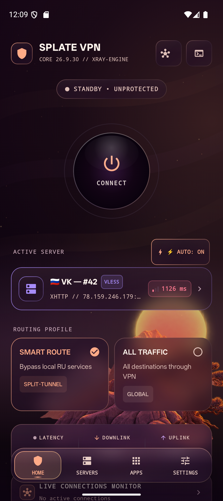
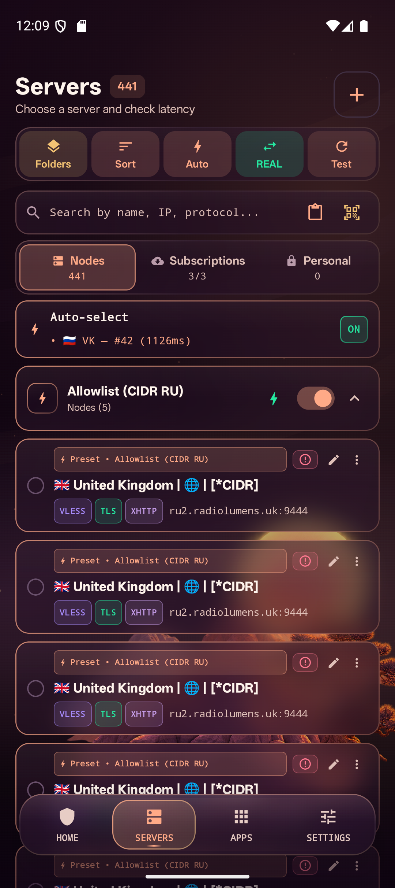
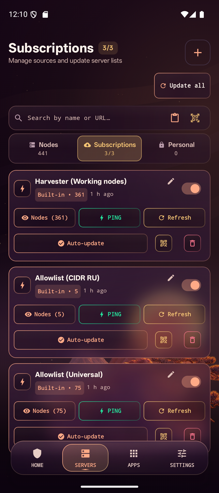
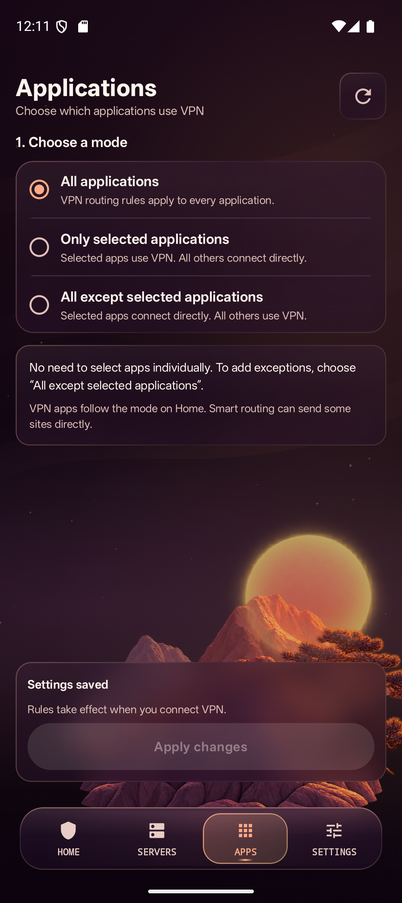
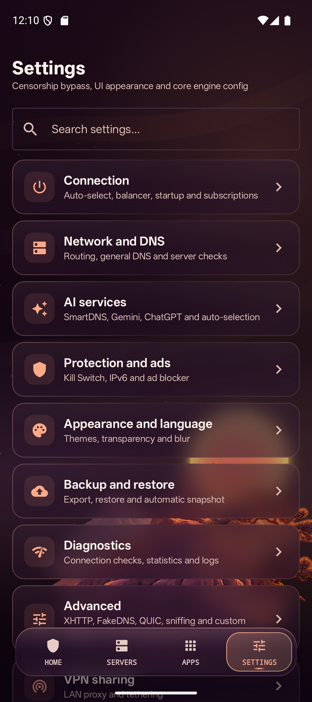
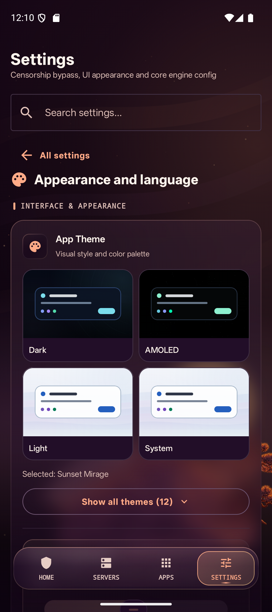

<p align="center">
  
</p>

<h1 align="center">SplateVPN</h1>

<p align="center"><a href="README.md">Русский</a> · <strong>English</strong></p>

<p align="center">
  An Android VPN client with Xray, AmneziaWG and Tor support.
</p>

<p align="center">
  <a href="https://github.com/splatedk-web/splatevpn-xray-client/releases"></a>
  <a href="https://splatevpn.wtpn.pro/"></a>
  <a href="https://www.donationalerts.com/r/danieldkgt"></a>
</p>

<p align="center">
  <a href="https://github.com/splatedk-web/splatevpn-xray-client-windows">Windows</a> ·
  <a href="https://github.com/splatedk-web/splatevpn-xray-client-linux">Linux</a> ·
  <a href="#protocols-and-import">Protocols</a> ·
  <a href="#screenshots">Screenshots</a> ·
  <a href="#installation">Installation</a> ·
  <a href="https://github.com/splatedk-web/splatevpn-xray-client/issues">Feedback</a>
</p>

---

## Features

<table>
  <tr>
    <td width="50%"><b>Connections</b><br />Servers and subscriptions, QR codes, AmneziaWG profiles and Tor bridges.</td>
    <td width="50%"><b>Automatic selection</b><br />HTTPS checks through each tunnel, selection by latency or speed, and failover.</td>
  </tr>
  <tr>
    <td><b>Routing</b><br />Smart routing, site rules and per-app VPN settings.</td>
    <td><b>DNS and controls</b><br />Smart DNS, DoH, notifications, widgets, automatic connection and backups.</td>
  </tr>
</table>

Connect using your own server, a subscription, built-in sources or the Tor network. Third-party server owners determine their availability and terms of use.

## Protocols and import

| Protocol or mode | Support |
| --- | --- |
| VLESS | TLS, Reality and Vision for compatible configurations. |
| XDrive | VLESS transport over cloud storage: Google Drive, S3 and API templates. Imports a complete JSON profile. |
| VMess | Connection links and profile editing. |
| Trojan | Connections with TLS. |
| Shadowsocks | `ss://` links. |
| Hysteria2 | `hy2://` and `hysteria2://` links, Salamander and port hopping. |
| AmneziaWG / WireGuard | `.conf` import, `awg://`, `vpn://` and `wireguard://` links, and a profile editor. |
| Tor | Direct connections or bridges using vanilla Tor, obfs4, WebTunnel and Snowflake. |
| SOCKS5 | `socks://` and `socks5://` links. |

Xray profiles can use TCP, WebSocket, gRPC, XHTTP, XDrive and other transports supported by the core. Client settings must match the server configuration.

Add servers using links, the clipboard or QR codes. Subscriptions can update manually or on a schedule. Search, folders and individual node controls are available. Imported full Xray profiles retain their proxy and outbound chain settings; the app manages inbound ports, DNS and routing.

AmneziaWG supports extended profile parameters and `vpn://` links containing a Base64-encoded text configuration. This does not cover every Amnezia container using that prefix. WARP addresses without a prefix receive `/32` for IPv4 or `/128` for IPv6. Private AWG profiles stored in the database are encrypted using Android Keystore.

**XDrive** carries VLESS traffic through cloud storage. Supported backends include Google Drive, S3 and API template providers. It requires a complete JSON profile with storage settings and VLESS encryption; a plain `vless://` link with `type=xdrive` is not enough.

## Screenshots

Android 15 with the Sunset theme. Individual screens may look different.

<table align="center">
  <tr><th>Home</th><th>Servers</th><th>Subscriptions</th></tr>
  <tr>
    <td></td>
    <td></td>
    <td></td>
  </tr>
  <tr><th>Applications</th><th>Settings</th><th>Appearance</th></tr>
  <tr>
    <td></td>
    <td></td>
    <td></td>
  </tr>
</table>

## Automatic server selection

The balancer checks HTTPS traffic through each candidate's tunnel. An open port or a successful TCP ping alone does not establish that a server works. VLESS, Hysteria2 and AmneziaWG participate in the same selection process.

- Selection by latency or speed, with additional checks for selected services.
- Initial selection, failover, or periodic searches for a better node.
- Verified standby nodes, temporary quarantine for failed servers, and handling of network changes.
- Manual server choices remain in place during background checks.
- The built-in WTPN subscription has priority when enabled.

Speed mode downloads data through the candidate tunnel. Samples run sequentially. The quick list shows up to ten verified nodes, with up to six speed samples per refresh. Each sample uses up to 4 MiB; the default hourly budget is 64 MiB. When the budget is exhausted, the app shows when sampling can resume. `Mbps not measured` does not mean a server is down.

Selection uses a time limit and the available results. It does not check every node on each connection or guarantee the fastest server in an entire subscription.

## Routing and DNS

**Smart routing** sends regional services directly and handles other destinations according to VPN rules. Region and interface language are separate settings: Russia, China, Iran or international. Sites reached through a direct route see your ISP address.

**All traffic** routes connections from selected apps through the VPN, subject to configured exceptions. The Applications tab lets you use the VPN for all apps, selected apps only, or all apps except those selected. Site and address rules support direct access, VPN routing, blocking and server assignments.

AI services have three routing options: regular VPN, direct Smart DNS, or Smart DNS through the VPN. Provider selection, automatic selection, address updates and failover after confirmed failures are available. DNS reachability and service access are checked separately so a login redirect or challenge page is not mistaken for successful access.

Other options include DoH, FakeDNS, IPv6 and QUIC controls, TLS fragmentation, and DNS-based ad filtering with exceptions. Smart DNS depends on a third-party provider. Domain filtering cannot remove ads served from the same domain as the content.

## Tor

Select Tor in the Servers tab. Paste bridges, scan a QR code, load an HTTPS subscription or import the TOP-100 list. Manual bridge selection, automatic selection and a request for a new circuit are available.

- **By latency:** uses TCP connection time to the bridge, not latency through the entire Tor circuit.
- **By speed:** compares a small group of up to three candidates by downloading data through real Tor circuits. Only successful samples are cached for the current network context.
- **Recovery:** checks both the Tor process and HTTPS traffic. After consecutive failures, the client rebuilds the connection while keeping the VPN interface open during recovery.

Tor carries TCP and DNS. UDP, including calls and other features that require it, does not work through Tor. Smart DNS and direct regional routes are not used in this mode. Speed and service access depend on bridges and exit nodes.

## Controls and interface

- Connect when opening the app, with a separate option to connect after device startup.
- Resume the VPN after a two-minute pause.
- Quick Settings tile, widgets and a notification showing latency, traffic and connection duration. Notification categories can be configured separately.
- Logs, connection diagnostics, speed tests and traffic statistics.
- Backups, settings transfer, WebDAV and saved network profiles.
- Local proxy sharing with address, port and authentication settings. The internal VPN SOCKS listener stays on loopback.
- Russian, English, Chinese and Persian interfaces, optional onboarding and guidance for Android permissions.
- Themes with animated images, transparency, blur and animation settings.

To block connections outside the VPN, enable Android's Always-on VPN and Block connections without VPN settings. The app provides a shortcut to them. IP-checking sites follow the same routing rules as other sites; their results do not confirm routing for every app.

## Installation

1. Download an APK from [Releases](https://github.com/splatedk-web/splatevpn-xray-client/releases). Most current phones use `arm64-v8a`; ARMv7, x86_64 and universal builds are also available.
2. Complete onboarding, or choose a region and routing mode without the walkthrough.
3. Add a server, subscription or AWG profile, or select Tor.
4. Choose a server or enable Auto, then connect and accept Android's VPN permission prompt.

Requires Android 8.0 / API 26 or newer.

## For developers

<details>
<summary><b>Build from source</b></summary>

You need JDK 21 and Android SDK 35. Set the SDK path in `local.properties` or through the Android SDK environment settings.

```bash
git clone https://github.com/splatedk-web/splatevpn-xray-client.git
cd splatevpn-xray-client
./gradlew assembleDebug
```

On Windows PowerShell, use `.\gradlew.bat assembleDebug`. APKs are written to `app/build/outputs/apk/debug/`. Configure your own signing key before distributing a release build.

Stack: Kotlin, Jetpack Compose, Hilt, Room, WorkManager, Xray and hev-socks5-tunnel. Component versions and checksums are listed in [NATIVE_COMPONENTS.json](NATIVE_COMPONENTS.json).

</details>

## Feedback and support

When opening an [issue](https://github.com/splatedk-web/splatevpn-xray-client/issues), include your APK version, Android version, protocol, network type and steps to reproduce the problem. Remove private keys, UUIDs and private subscription links before posting a report.

[Support development through DonationAlerts](https://www.donationalerts.com/r/danieldkgt).

## Licenses

Original code: [Apache License 2.0](LICENSE). Its scope and third-party licenses are described in [LICENSING.md](LICENSING.md).
