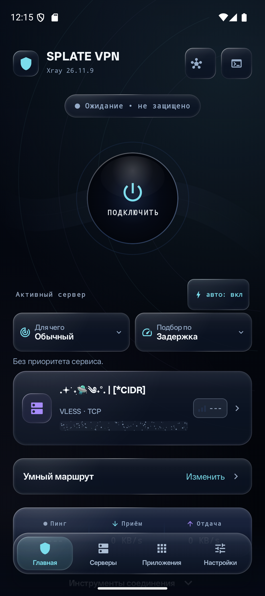
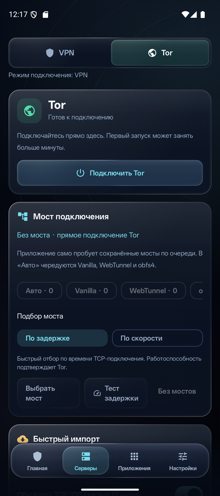
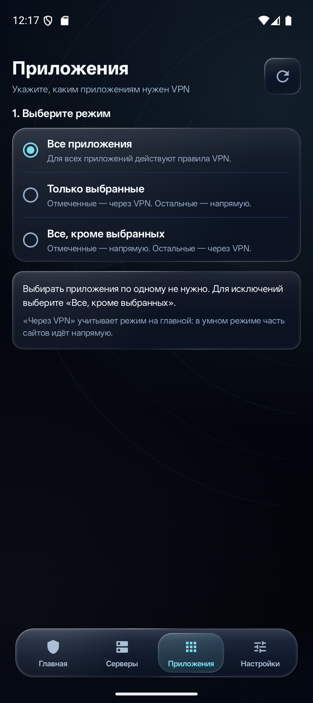
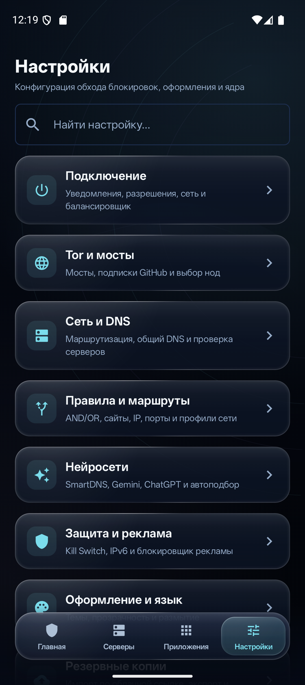
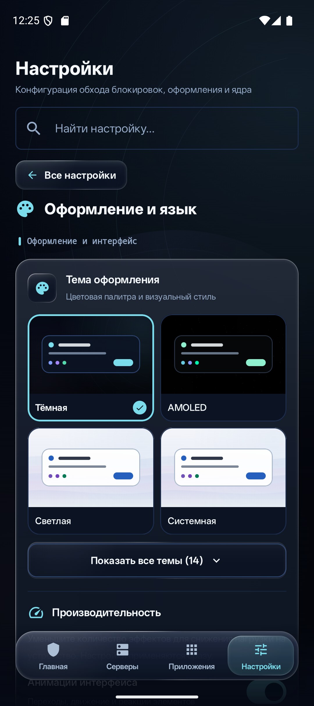
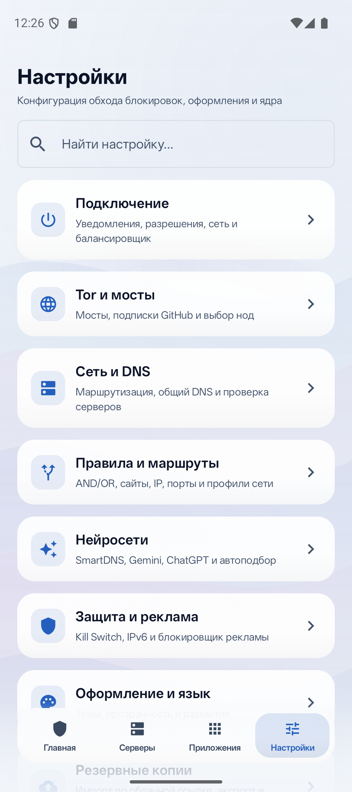

# SplateVPN для Android

**Русский** · [English](README.en.md)

VPN-клиент с Xray, AmneziaWG и Tor для Android 8.0 и новее, включая Android TV.

[](https://github.com/splatedk-web/splatevpn-xray-client/stargazers)


[Скачать APK](https://github.com/splatedk-web/splatevpn-xray-client/releases) · [Windows](https://github.com/splatedk-web/splatevpn-xray-client-windows) · [Linux](https://github.com/splatedk-web/splatevpn-xray-client-linux) · [История изменений](CHANGELOG.md)

## Возможности

- VLESS, VMess, Trojan, Shadowsocks, Hysteria2, AmneziaWG, WireGuard и SOCKS5. Импорт ссылок, QR-кодов, подписок, файлов AWG и JSON-профилей Xray.
- Автоподбор по задержке или скорости и переключение на резервный сервер при сбое.
- Маршрутизация по приложениям и доменам, Smart DNS, DoH и фильтрация рекламы по DNS.
- Tor с прямым подключением или мостами obfs4, WebTunnel и Snowflake. Через Tor передаются TCP и DNS.
- Виджеты, плитка быстрых настроек, статистика трафика, резервные копии и перенос настроек.

## Скриншоты

| Главная | Tor | Приложения |
| --- | --- | --- |
|  |  |  |

| Настройки | Темы | Светлая тема |
| --- | --- | --- |
|  |  |  |

## Установка и сборка

Скачайте APK для своего устройства из [Releases](https://github.com/splatedk-web/splatevpn-xray-client/releases). Для большинства современных телефонов подходит `arm64-v8a`. После запуска добавьте свой сервер или подписку либо выберите Tor.

Для сборки нужны JDK 21 и Android SDK 35. Укажите каталог SDK в переменной `ANDROID_HOME` или в локальном `local.properties`.

```sh
./gradlew :app:assembleDebug
```

В PowerShell используйте `.gradlew.bat :app:assembleDebug`. APK появятся в `app/build/outputs/apk/debug/`.

Чтобы подписать свою release-сборку, укажите `storeFile` (абсолютный путь), `storePassword`, `keyAlias` и `keyPassword` в локальном `splate-private.properties` в корне проекта. Для обычной сборки этот файл не нужен.

[Ошибки и предложения](https://github.com/splatedk-web/splatevpn-xray-client/issues) · [Политика конфиденциальности](PRIVACY_POLICY.md) · [Лицензии](LICENSING.md)
