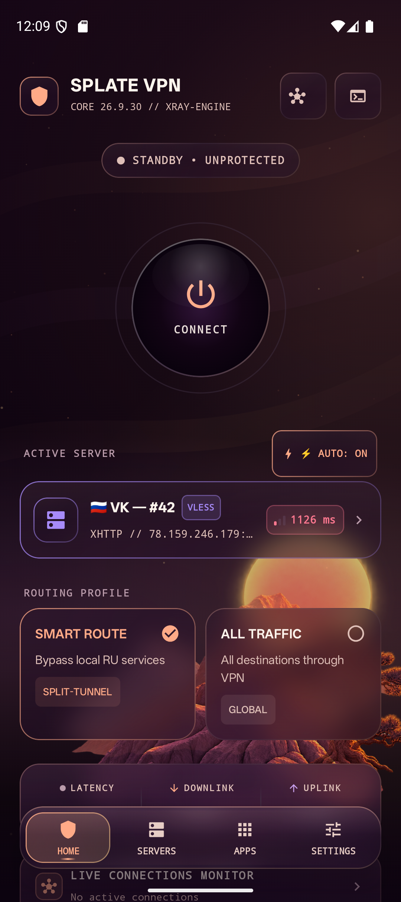
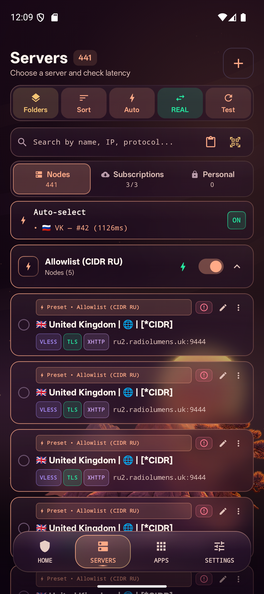
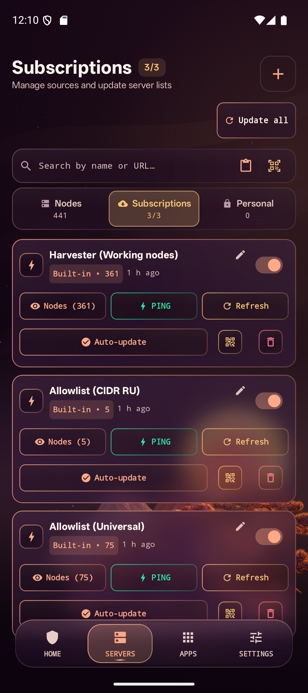
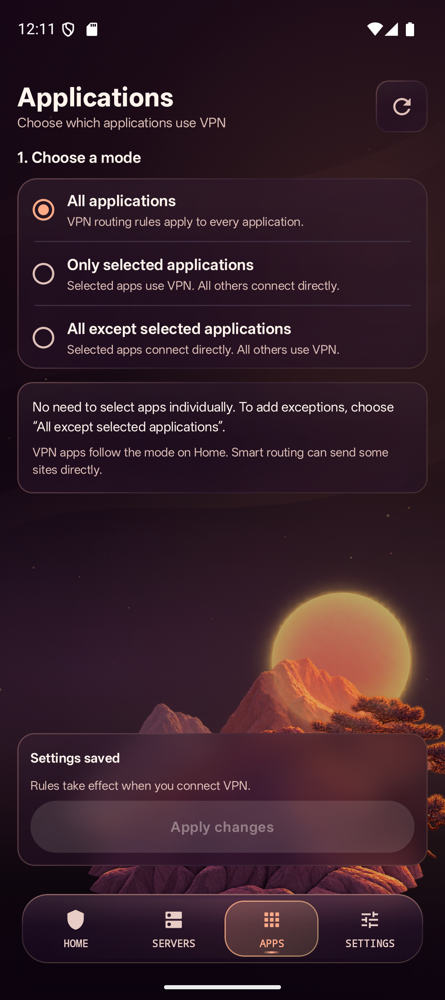
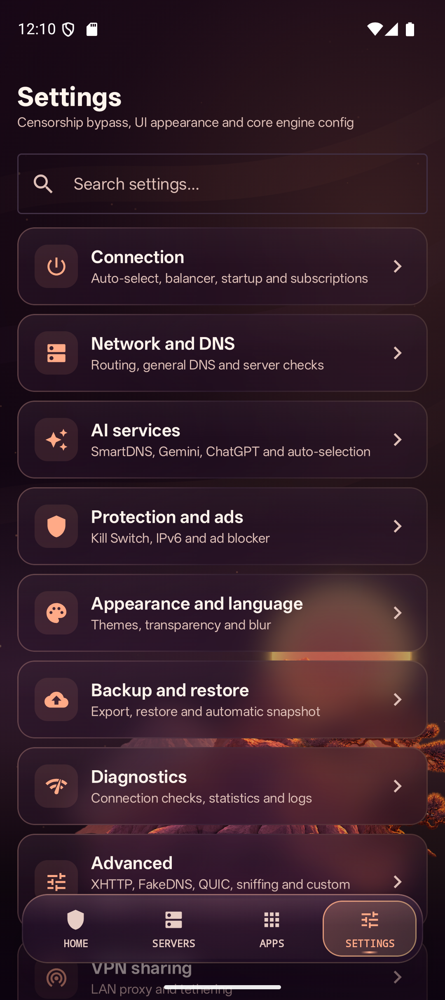
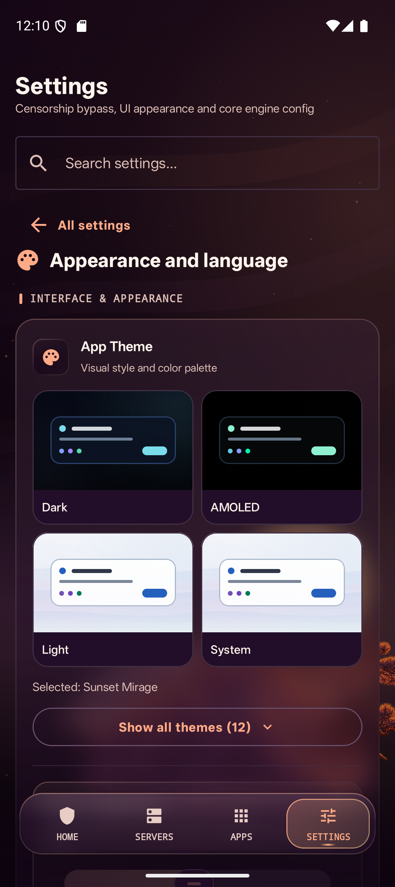

<p align="center">
  
</p>

<h1 align="center">SplateVPN — VPN-клиент для Android на Xray</h1>

<p align="center">
  Android VPN с поддержкой VLESS / Reality, VMess, Trojan и Shadowsocks.<br />
  Импорт подписок, автоматический выбор сервера, раздельное туннелирование и DNS-настройки.
</p>

<p align="center">
  
  
  
  
</p>

<p align="center">
  <a href="https://github.com/splatedk-web/splatevpn-xray-client/releases">Скачать APK</a> ·
  <a href="#скриншоты">Скриншоты</a> ·
  <a href="#быстрый-старт">Быстрый старт</a> ·
  <a href="https://github.com/splatedk-web/splatevpn-xray-client/issues">Сообщить об ошибке</a>
</p>

> Проект находится в активной разработке. Версия в исходниках — **1.2.3**; доступность APK с последними изменениями проверяйте в разделе Releases. Для подключения нужен рабочий сервер или подписка.

## О приложении

**SplateVPN (Splate VPN)** — приложение для подключения Android-устройства к совместимым прокси-серверам через системный VPN-интерфейс. Сетевую конфигурацию обрабатывает Xray-core, передачу трафика из TUN-интерфейса — hev-socks5-tunnel. Root не требуется.

Это клиент, а не собственная сеть VPN-серверов. Можно импортировать свою конфигурацию или подписку. Встроенные списки используют сторонние публичные источники: доступность, скорость и условия работы таких серверов зависят от их владельцев. Число узлов на скриншотах — пример, а не гарантированное количество рабочих серверов.

**English:** SplateVPN is an Android VPN client powered by Xray-core and hev-socks5-tunnel. It supports VLESS / Reality, VMess, Trojan, Shadowsocks, subscription import, automatic server selection, per-app split tunneling and configurable DNS. Bring a compatible server or subscription; the app does not operate its own VPN server network.

## Скриншоты

Снимки текущей сборки сделаны на эмуляторе Android 15 **20 октября 2026 года**. Тема — **Sunset**, язык интерфейса — английский. Также доступен русский язык. Изображения открываются в полном размере по нажатию.

<table>
  <tr><th>Главная</th><th>Серверы</th><th>Подписки</th></tr>
  <tr>
    <td width="33%"><a href="docs/screenshots/home.png"></a></td>
    <td width="33%"><a href="docs/screenshots/servers.png"></a></td>
    <td width="33%"><a href="docs/screenshots/subscriptions.png"></a></td>
  </tr>
  <tr><th>Приложения</th><th>Настройки</th><th>Оформление</th></tr>
  <tr>
    <td><a href="docs/screenshots/applications.png"></a></td>
    <td><a href="docs/screenshots/settings.png"></a></td>
    <td><a href="docs/screenshots/appearance.png"></a></td>
  </tr>
</table>

## Возможности

### Подключение и серверы

- Протоколы **VLESS, VMess, Trojan и Shadowsocks**, поддержка Reality и Vision для совместимых конфигураций.
- Транспорты XHTTP, TCP, WebSocket, gRPC и другие варианты, поддерживаемые конфигурацией Xray.
- Импорт ссылок и подписок, вставка из буфера обмена, сканирование QR-кодов и редактор параметров сервера.
- Поиск, группировка, сортировка и обновление подписок вручную или по расписанию.
- TCP-проверка доступности и **REAL-проверка через Xray**. Массовая REAL-проверка выполняет до **6 замеров одновременно**; при активном VPN пакет ограничен 4 замерами, чтобы оставить ресурсы балансировщику.
- Автоматический выбор сервера и попытки переключения при проблемах с подключением. Измерения помогают выбрать узел, но не гарантируют скорость или непрерывность работы.

### Маршрутизация и приложения

- **Умный маршрут**: разделение прямых и проксируемых направлений по правилам, в том числе для российских сервисов.
- **Весь трафик**: профиль направления трафика через VPN с учётом настроенных исключений и правил.
- Пользовательские правила доменов: напрямую, через VPN или блокировать.
- Три режима во вкладке **«Приложения»**:

| Режим | Поведение |
| --- | --- |
| Все приложения | Правила VPN применяются ко всем приложениям. |
| Только выбранные | Выбранные приложения используют VPN, остальные подключаются напрямую. |
| Все, кроме выбранных | Выбранные приложения подключаются напрямую, остальные используют VPN. |

Выбор сохраняется кнопкой **«Применить изменения»**. Для режима «Только выбранные» нужно отметить хотя бы одно приложение. Приложения внутри VPN следуют профилю на главной: умный маршрут может отправлять часть сайтов напрямую.

### DNS, защита и AI-сервисы

- Настройки DNS, DoH, FakeDNS, IPv6, QUIC, sniffing и TLS-фрагментации.
- Отдельные настройки AI-сервисов: режим VPN или SmartDNS, выбор провайдера и автоматический подбор настроек.
- DNS-фильтрация рекламы с базой AdGuard DNS, фоновой загрузкой обновлений и исключениями доменов.
- Настройка Kill Switch и совместимости подключения.

SmartDNS зависит от доступности стороннего провайдера и не гарантирует доступ к конкретному сервису. В этом режиме соответствующие запросы могут идти напрямую к инфраструктуре SmartDNS, а не через выбранный VPN-сервер. DNS-фильтрация не удаляет всю рекламу: контент и реклама могут загружаться с одного домена. Подробности: [SmartDNS](SMART_DNS_2026-10-16.md), [подбор DNS для AI](AI_DNS_AUTOSELECT_2026-10-16.md), [фильтры рекламы](AD_FILTERS_UPDATE_2026-10-17.md).

### Диагностика и управление

- Статистика трафика за день и месяц, история и графики.
- Проверка доступности сервисов, диагностика подключения и встроенный тест скорости.
- Журнал событий Xray и VPN с поиском, фильтрацией и экспортом.
- Резервное копирование и восстановление настроек, серверов и подписок.
- Виджеты рабочего стола и плитка быстрых настроек Android.

Статистика учитывает трафик VPN-интерфейса, включая прямые маршруты внутри него. Трафик приложений, исключённых из VPN, в неё не входит. Проверка публичной страницы сервиса не подтверждает работу входа в аккаунт, видео или звонков.

### Интерфейс

- Jetpack Compose и Material 3, анимированные фоны, переходы и стеклянные карточки.
- **12 вариантов оформления**: Dark, AMOLED, Light, System, Cyberpunk, OnePlus, Aurora, Sunset, Ocean, Sakura, Pony и Winx.
- Настройка прозрачности и размытия; изображения виджетов согласованы с темой приложения.
- Русский и английский языки, поиск по настройкам и разделение параметров по категориям.

## Последние изменения — 20 октября 2026

- Добавлены анимированные переходы между категориями настроек.
- Исправлены артефакты стеклянных карточек в диалогах и дрожание индикатора вкладок серверов.
- Обновлено оформление виджетов с использованием изображений текущих тем.
- Ускорена массовая проверка серверов; ожидание очереди больше не расходует таймаут самого замера.
- Переработана вкладка «Приложения»: три явных режима, применение и отмена изменений, пояснения маршрутизации.

Более ранние записи доступны в [CHANGELOG.md](CHANGELOG.md) и [заметках после 1.2.2](RELEASE_NOTES_AFTER_1.2.2.md). Они описывают соответствующие этапы разработки; текущие возможности перечислены выше.

## Быстрый старт

1. Скачайте подходящий APK из [Releases](https://github.com/splatedk-web/splatevpn-xray-client/releases) и установите его.
2. Откройте **«Серверы» → «+»**, добавьте ссылку сервера или URL подписки. Также можно вставить данные из буфера или отсканировать QR-код.
3. Обновите подписку, проверьте серверы и выберите узел либо включите автоматический выбор.
4. На главной выберите профиль маршрутизации. При необходимости настройте вкладку «Приложения».
5. Нажмите кнопку подключения и подтвердите системный запрос Android на создание VPN-соединения.

**Требования:** Android **8.0 / API 26** и новее. В проекте настроены APK для **arm64-v8a**, **armeabi-v7a**, **x86_64**, а также универсальная сборка. Для обычного современного телефона чаще всего подходит `arm64-v8a`; `x86_64` используется, в частности, на эмуляторах.

## Сборка из исходников

Стек проекта: Kotlin **2.1.0**, Android Gradle Plugin **8.7.3**, Jetpack Compose, Hilt **2.54**, Room **2.7.0**, Coroutines и WorkManager. VPN-слой использует Android `VpnService`, Xray-core **26.9.30** и hev-socks5-tunnel. Версии и контрольные суммы нативных компонентов указаны в [NATIVE_COMPONENTS.json](NATIVE_COMPONENTS.json).

Для сборки нужны **JDK 21**, Android SDK **35** и Android Studio с поддержкой используемого Android Gradle Plugin. В `gradle/gradle-daemon-jvm.properties` выбран daemon toolchain Oracle JDK 21; целевая версия Java/Kotlin-байткода приложения — 17. Путь к SDK задаётся через локальный `local.properties` (`sdk.dir`) или окружение Android SDK.

```bash
git clone https://github.com/splatedk-web/splatevpn-xray-client.git
cd splatevpn-xray-client

# Linux / macOS
./gradlew assembleDebug

# Windows PowerShell
.\gradlew.bat assembleDebug
```

APK появляются в `app/build/outputs/apk/debug/`. Сборка `assembleRelease` использует R8 и уменьшение ресурсов; для распространения release-APK потребуется настроить подпись собственным ключом.

Локальные unit-тесты:

```bash
./gradlew testDebugUnitTest
# Windows: .\gradlew.bat testDebugUnitTest
```

## Обратная связь

Создайте [Issue](https://github.com/splatedk-web/splatevpn-xray-client/issues), укажите версию приложения и Android, шаги воспроизведения и приложите скриншот или диагностический журнал. Перед публикацией удалите из отчёта ключи, UUID, ссылки приватных подписок и другие личные данные.

Предложения и pull request приветствуются.
