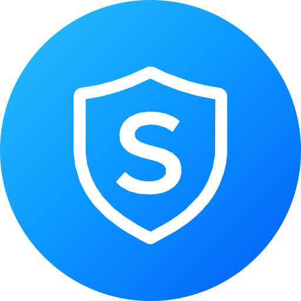
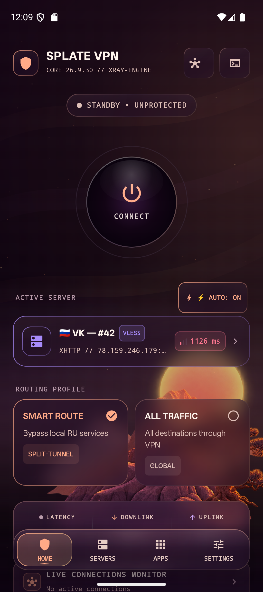
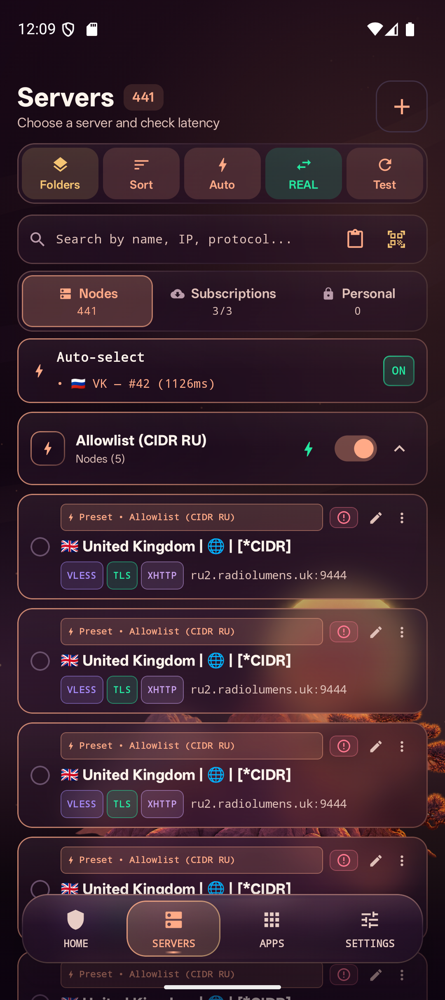
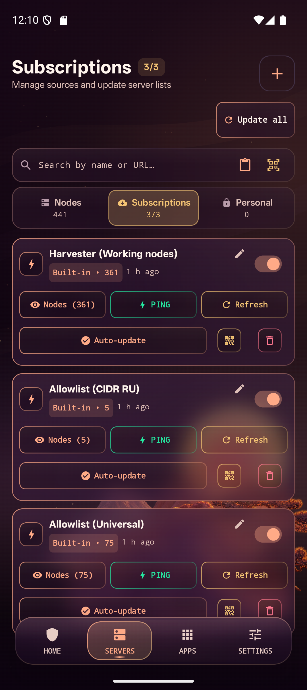
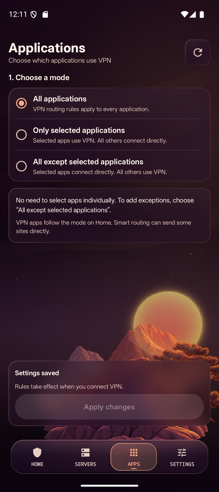
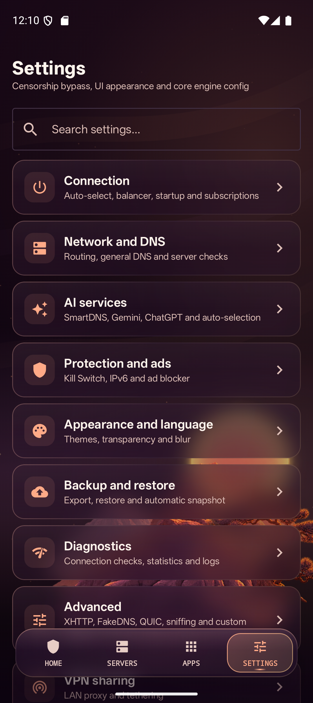
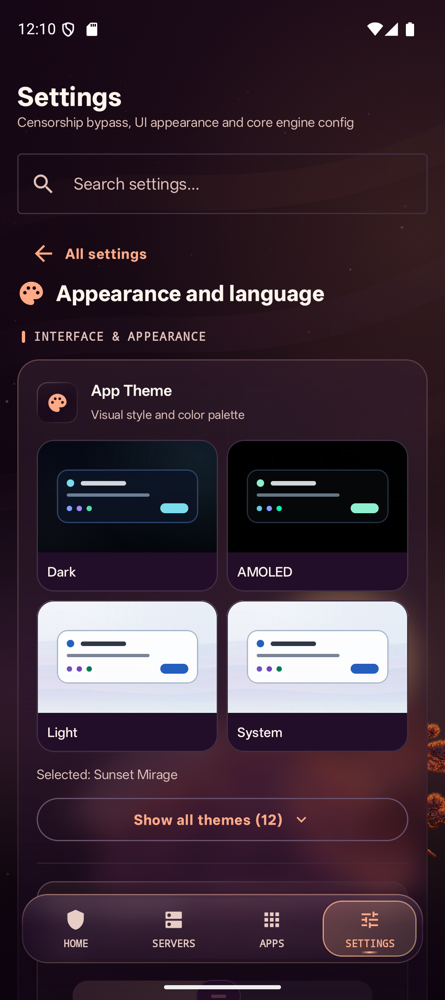

<p align="center">
  
</p>

<h1 align="center">SplateVPN</h1>

<p align="center">
  VPN-клиент для Android с поддержкой Xray, AmneziaWG и Tor.
</p>

<p align="center">
  <a href="https://github.com/splatedk-web/splatevpn-xray-client/releases"></a>
  <a href="https://splatevpn.wtpn.pro/"></a>
  <a href="https://www.donationalerts.com/r/danieldkgt"></a>
</p>

<p align="center">
  <a href="https://github.com/splatedk-web/splatevpn-xray-client-windows">Windows</a> ·
  <a href="https://github.com/splatedk-web/splatevpn-xray-client-linux">Linux</a> ·
  <a href="#протоколы-и-импорт">Протоколы</a> ·
  <a href="#скриншоты">Скриншоты</a> ·
  <a href="#установка">Установка</a> ·
  <a href="https://github.com/splatedk-web/splatevpn-xray-client/issues">Обратная связь</a>
</p>

---

## Возможности

<table>
  <tr>
    <td width="50%"><b>Подключение</b><br />Серверы и подписки, QR-коды, профили AmneziaWG и мосты Tor.</td>
    <td width="50%"><b>Автоподбор</b><br />Проверка HTTPS через туннель, выбор по задержке или скорости, переключение на резерв.</td>
  </tr>
  <tr>
    <td><b>Маршрутизация</b><br />Умный маршрут, правила для сайтов и выбор приложений, использующих VPN.</td>
    <td><b>DNS и управление</b><br />Smart DNS, DoH, уведомления, виджеты, автоподключение и резервные копии.</td>
  </tr>
</table>

Для подключения используйте свой сервер, подписку, встроенные источники или сеть Tor. Условия работы сторонних серверов зависят от их владельцев.

## Протоколы и импорт

| Протокол или режим | Поддержка |
| --- | --- |
| VLESS | TLS, Reality и Vision для совместимых конфигураций. |
| VMess | Импорт ссылок и настройка профиля. |
| Trojan | Подключение с TLS. |
| Shadowsocks | Импорт ссылок `ss://`. |
| Hysteria2 | Ссылки `hy2://` и `hysteria2://`, Salamander и смена портов. |
| AmneziaWG / WireGuard | Импорт `.conf`, ссылки `awg://`, `vpn://` и `wireguard://`, редактор профиля. |
| Tor | Без мостов либо с обычными мостами, obfs4, WebTunnel и Snowflake. |
| SOCKS5 | Импорт ссылок `socks://` и `socks5://`. |

Для профилей Xray доступны TCP, WebSocket, gRPC, XHTTP и другие поддерживаемые ядром транспорты. Параметры клиента должны соответствовать настройкам сервера.

Серверы можно добавить ссылкой, из буфера обмена или QR-кода. Подписки обновляются вручную и по расписанию; доступны поиск, папки и отключение отдельных узлов. Полный импортированный Xray-профиль сохраняет параметры прокси и его цепочки, а входящие порты, DNS и маршрутизацию задаёт приложение.

AmneziaWG поддерживает расширенные параметры профилей и ссылки `vpn://` с текстовой конфигурацией в Base64. Это не означает поддержку всех контейнеров Amnezia с таким префиксом. Адреса WARP без маски получают `/32` для IPv4 или `/128` для IPv6. Приватные AWG-профили в базе шифруются через Android Keystore.

## Скриншоты

Интерфейс на Android 15 с темой Sunset. Внешний вид отдельных экранов может отличаться.

<table align="center">
  <tr><th>Главная</th><th>Серверы</th><th>Подписки</th></tr>
  <tr>
    <td></td>
    <td></td>
    <td></td>
  </tr>
  <tr><th>Приложения</th><th>Настройки</th><th>Оформление</th></tr>
  <tr>
    <td></td>
    <td></td>
    <td></td>
  </tr>
</table>

## Автоподбор серверов

Балансировщик проверяет HTTPS через туннель кандидата. Открытый порт или успешный TCP-пинг сами по себе не делают сервер рабочим. VLESS, Hysteria2 и AmneziaWG участвуют в общем подборе.

- Выбор по задержке или скорости, с отдельными проверками для выбранных сервисов.
- Режимы: подбор при подключении, переключение при сбое или периодический поиск лучшего узла.
- Проверенный резерв, временный карантин отказавших серверов и учёт смены сети.
- Сохранение ручного выбора при фоновых проверках.
- Приоритет встроенной подписки WTPN, когда она включена.

В режиме скорости выполняется реальная загрузка данных через кандидата. Замеры идут последовательно. Быстрый список показывает до десяти проверенных узлов; за обновление выполняется до шести замеров скорости. Один тест расходует до 4 МиБ, часовой лимит по умолчанию — 64 МиБ. При его исчерпании отображается время возобновления. «Нет замера Mbps» не означает, что сервер не работает.

Подбор ограничен временем и доступными результатами. Он не перебирает все узлы при каждом подключении и не гарантирует выбор самого быстрого из всей подписки.

## Маршрутизация и DNS

**Умный маршрут** отправляет региональные сервисы напрямую, остальные направления — по правилам VPN. Регион выбирается отдельно от языка: Россия, Китай, Иран или международный вариант. Сайт с прямым маршрутом видит IP вашего провайдера.

**Весь трафик** направляет соединения выбранных приложений через VPN с учётом заданных исключений. Во вкладке «Приложения» можно включить VPN для всех, только выбранных или всех, кроме выбранных приложений. Для сайтов и адресов доступны правила «напрямую», «через VPN», «блокировать» и назначение серверов.

Для AI-сервисов есть три варианта: обычный VPN, Smart DNS напрямую или Smart DNS через VPN. Доступны выбор провайдера, автоподбор, обновление его адресов и переключение при подтверждённом сбое. Проверка DNS отдельно от проверки сервиса помогает не принимать страницу входа или защитную заглушку за успешный доступ.

Также доступны DoH, FakeDNS, настройки IPv6 и QUIC, TLS-фрагментация и DNS-фильтрация рекламы с исключениями. Smart DNS зависит от стороннего провайдера; фильтрация по доменам не удаляет рекламу, которая загружается с того же домена, что и основной контент.

## Tor

Выберите Tor во вкладке «Серверы». Мосты можно вставить, отсканировать из QR, загрузить по HTTPS-ссылке или импортировать из списка TOP-100. Есть ручной выбор моста, автоматический подбор и запрос новой цепочки.

- **По задержке:** используется время TCP-подключения до моста. Это не задержка всей Tor-цепочки.
- **По скорости:** небольшая группа до трёх кандидатов сравнивается загрузкой данных через настоящие Tor-цепочки. Сохраняются только успешные замеры для текущего контекста сети.
- **Восстановление:** проверяется не только процесс Tor, но и HTTPS-трафик. После нескольких последовательных отказов клиент перестраивает подключение, сохраняя VPN-интерфейс на время восстановления.

Tor передаёт TCP и DNS. UDP, включая звонки и другие функции, которым нужен UDP, через него не работает. Smart DNS и прямые региональные маршруты в этом режиме не используются. Скорость и доступность сервисов зависят от мостов и выходных узлов.

## Управление и интерфейс

- Подключение при открытии приложения и отдельная настройка автозапуска после загрузки устройства.
- Возобновление VPN после двухминутной паузы.
- Плитка быстрых настроек, виджеты и уведомление с задержкой, трафиком и длительностью соединения. Категории уведомлений настраиваются отдельно.
- Журнал, диагностика, тест скорости и статистика трафика.
- Резервные копии, перенос настроек, WebDAV и сохранение сетевых профилей.
- Локальная раздача прокси с настройкой адреса, порта и авторизации. SOCKS для внутренней работы VPN остаётся на loopback.
- Русский, английский, китайский и персидский интерфейс; необязательное обучение и рекомендации по разрешениям Android.
- Темы с анимированными изображениями, настройка прозрачности, размытия и анимаций.

Системная блокировка соединений без VPN включается в настройках Android вместе с «Постоянной VPN». В приложении есть переход к этим настройкам. Сайты проверки IP подчиняются тем же маршрутам, что и остальные сайты; их результат не подтверждает маршрутизацию каждого приложения.

## Установка

1. Скачайте APK из [Releases](https://github.com/splatedk-web/splatevpn-xray-client/releases). Для большинства современных телефонов подходит `arm64-v8a`; доступны также ARMv7, x86_64 и универсальная сборка.
2. Пройдите начальную настройку или выберите регион и режим без обучения.
3. Добавьте сервер, подписку, AWG-профиль либо выберите Tor.
4. Выберите сервер или включите «Авто», затем нажмите подключение и подтвердите запрос Android.

Нужен Android 8.0 / API 26 или новее. 

## Для разработчиков

<details>
<summary><b>Сборка из исходников</b></summary>

Нужны JDK 21 и Android SDK 35. Путь к SDK задаётся в `local.properties` или через окружение Android SDK.

```bash
git clone https://github.com/splatedk-web/splatevpn-xray-client.git
cd splatevpn-xray-client
./gradlew assembleDebug
```

В Windows PowerShell используйте `.\gradlew.bat assembleDebug`. APK появятся в `app/build/outputs/apk/debug/`. Для распространяемой release-сборки нужно настроить подпись своим ключом. 

Стек: Kotlin, Jetpack Compose, Hilt, Room, WorkManager, Xray и hev-socks5-tunnel. Версии и контрольные суммы компонентов указаны в [NATIVE_COMPONENTS.json](NATIVE_COMPONENTS.json).

</details>

## Обратная связь и поддержка

В [Issue](https://github.com/splatedk-web/splatevpn-xray-client/issues) укажите версию APK, Android, протокол, тип сети и шаги воспроизведения. Перед публикацией отчёта удалите ключи, UUID и ссылки приватных подписок.

[Поддержать разработку через DonationAlerts](https://www.donationalerts.com/r/danieldkgt).

## Лицензии

Собственный код: [Apache License 2.0](LICENSE). Область действия и лицензии сторонних компонентов описаны в [LICENSING.md](LICENSING.md).
